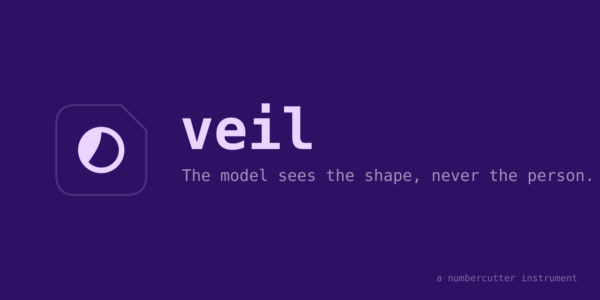

<p align="center"></p>

**The model sees the shape, never the person.**

veil swaps personal data for stable placeholders like `⟦EMAIL_1⟧` before text reaches a model, and puts the real values back in the answer. It runs as a library or as a drop-in proxy for OpenAI-compatible chat APIs, and keeps a tamper-evident audit log that never holds a raw value.

## Quick start

Needs [Bun](https://bun.sh) 1.1 or newer. No accounts, no API keys: the example talks to a local mock model.

```sh
git clone https://github.com/numbercutter/veil && cd veil
bun examples/proxy.ts
```

```
app sent:
  Refund Maria Okafor (maria.okafor@example.com, +1 415 555 0132). Card 4242 4242 4242 4242, ...

upstream saw:
  Refund ⟦NAME_1⟧ (⟦EMAIL_1⟧, ⟦PHONE_1⟧). Card ⟦CARD_1⟧, SSN ⟦SSN_1⟧, IBAN ⟦IBAN_1⟧, last login from ⟦IP_1⟧.

app got back:
  Noted. I will follow up with Refund Maria Okafor (maria.okafor@example.com, +1 415 555 0132). ...

raw values in upstream traffic: 0
raw values in audit log:        0

verify-log: ok, 2 entries
verify-log after editing one field: line 1: content does not match its hash
```

## Usage

### Library

```ts
import { mask, unmask } from "@numbercutter/veil";

const { text, session } = mask("Email ada@example.com about card 4111 1111 1111 1111", {
  names: ["Ada Lovelace"],
  terms: ["Project Nightjar"],
});
// text: "Email ⟦EMAIL_1⟧ about card ⟦CARD_1⟧"

const answer = await callYourModel(text);
console.log(unmask(answer, session));
```

Pass the same `session` to several `mask` calls and a value keeps its placeholder across them. `session.toJSON()` and `Session.from()` let you store the vault between processes; it holds the raw values, so treat it like the data itself.

| placeholder | detects |
|---|---|
| `EMAIL` | email addresses |
| `PHONE` | North American numbers with separators, `+` international numbers |
| `SSN` | US social security numbers written `123-45-6789` |
| `CARD` | 13 to 19 digit card numbers that pass the Luhn check |
| `IP` | IPv4 addresses |
| `IBAN` | IBANs that pass the mod-97 check, compact or in groups of four |
| `NAME`, `TERM` | your own lists, matched case-insensitively on word boundaries |

### Proxy

Set your client's base URL to veil instead of the provider. Your `Authorization` header is passed through untouched.

```sh
VEIL_UPSTREAM=https://api.openai.com/v1 bun src/cli.ts serve --port 8787 --names "Ada Lovelace"
# client base URL: http://127.0.0.1:8787/v1
```

To try it offline, run `bun examples/mock-upstream.ts` in one terminal, then:

```sh
VEIL_UPSTREAM=http://127.0.0.1:9999/v1 bun src/cli.ts serve
curl -s localhost:8787/v1/chat/completions -H 'content-type: application/json' \
  -d '{"model":"m","messages":[{"role":"user","content":"Email jo@corp.io about 4111 1111 1111 1111"}]}'
bun src/cli.ts verify-log
```

The mock terminal prints `[{"role":"user","content":"Email ⟦EMAIL_1⟧ about ⟦CARD_1⟧"}]`.

### CLI

```sh
bun src/cli.ts mask "Call (415) 555-0132 from 10.0.0.7"          # Call ⟦PHONE_1⟧ from ⟦IP_1⟧
echo "jo@corp.io" | bun src/cli.ts mask --json                    # masked text plus the vault
bun src/cli.ts verify-log .veil/audit.jsonl                       # exit 1 on tampering
```

## How it works

Each detector proposes matches; overlaps resolve to the earliest, longest one. Every distinct value gets one placeholder per session, so `ADA@example.com` and `ada@example.com` both become `⟦EMAIL_1⟧`, and the model can still tell people apart. Unmasking replaces every placeholder it knows and leaves unknown ones alone.

The proxy masks message text, text parts and tool-call arguments, forwards the request, and unmasks the returned message content and tool-call arguments.

Each request writes two lines to `.veil/audit.jsonl`: what was masked and what was restored. A line records the placeholder, its type and an HMAC-SHA256 of the value, keyed by `.veil/audit.key` (or `VEIL_AUDIT_KEY`) so short values like SSNs cannot be brute-forced from the log alone. Every line carries the hash of the line before it, so editing, reordering or deleting a line breaks the chain from that line on.

## Limits

- Pattern matching, not understanding. Names and other free-text identifiers are only caught if you list them; addresses, dates of birth and national IDs other than US SSNs are not detected. Expect some misses and some false positives.
- Non-streaming only. Requests with `stream: true` are refused, and only `/v1/chat/completions` is proxied.
- If a model rewrites a placeholder (drops the brackets, changes the number), that spot cannot be restored.
- Equal values restore to the first spelling seen in the session.
- The log chain shows edits within the file, but not a cut from the end. Keep the `head` hash printed by `verify-log` somewhere else if that matters.
- The vault lives in memory for the length of one proxied request; veil itself stores no raw values on disk.

<sub>A numbercutter instrument · MIT</sub>
